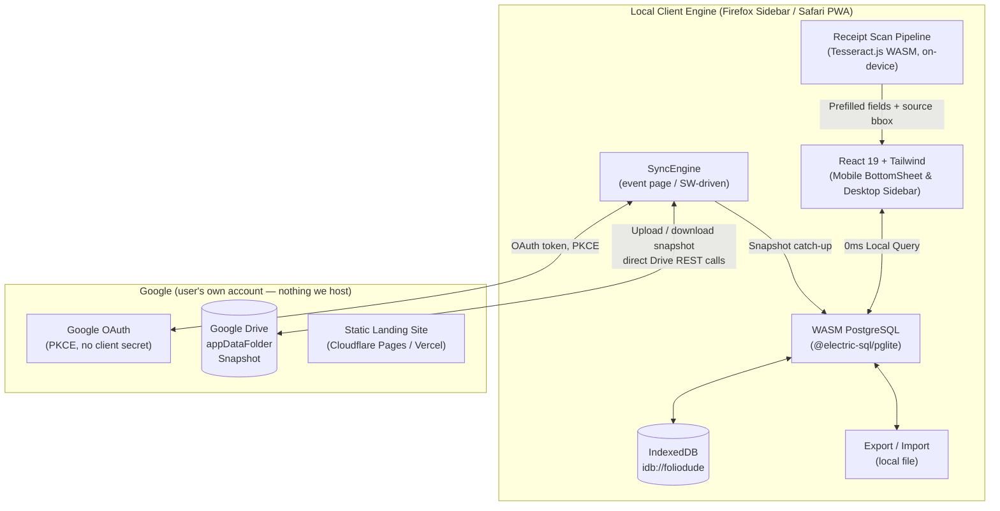
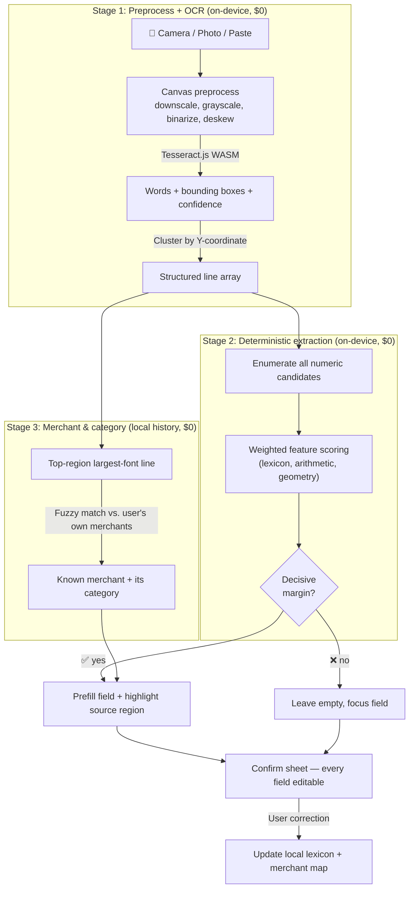

# Architecture Migration Plan: FolioDude to Local-First Extension & PWA

## 1. Executive Summary & Goal

Transition **FolioDude** from a Web SaaS (Next.js SSR + remote Supabase PostgreSQL + VPS Docker) into a **local-first Firefox sidebar extension and standalone iOS PWA**.

**Current Target Scope (Narrowed for Execution):**
1. **Firefox Desktop (Primary Dev/Test Target)** — Sidebar WebExtension, for rapid iteration.
2. **Safari iOS (Mobile Portrait)** — Standalone PWA ("Add to Home Screen"), the end-user experience.

### Core Targets
- **Zero Server Maintenance ($0/month)** — no VPS, no Docker, no always-on database, no backend project of our own to pause or pay for. Cloudflare Pages/Vercel for static hosting; Google Sign-In + the user's own Google Drive for optional sync (§4, §5 Phase 4).
- **Ultra-Fast Local Performance** — all financial CRUD runs in-browser via `@electric-sql/pglite` (WASM PostgreSQL), zero network latency.
- **Zero-Fee Mobile Deployment** — iOS PWA avoids Apple's $99/year developer fee. This is also why sign-in is **Google-only**: Sign in with Apple requires enrolling in the paid Apple Developer Program regardless of whether it's paired with iCloud storage, so adding it would reintroduce the exact fee this target exists to avoid. GitHub/Microsoft sign-in were considered and dropped too — each would need its own storage integration (a private repo, OneDrive) for no benefit over Google alone.
- **Top-Tier Mobile Portrait Experience** — one-handed logging, iOS safe-area adaptation, `100dvh`, gesture-driven bottom sheets.
- **Durable Data** — the local database is the source of truth, so backup is a correctness requirement, not a feature. Local export lands in Phase 2; Google Drive sync in Phase 4. A user who never signs in still has full local export/import as their backup path.

### Standing Constraint: Pre-Release — No Backward Compatibility

Nothing has shipped. There is no installed base, so no change owes compatibility
to anything: schema defects are corrected in the migration that introduced them
rather than in a new corrective one, a stale development database is wiped
rather than designed around, and legacy code is deleted rather than quarantined.
The append-only migration rule in `lib/db/migrate.ts` starts applying at first
release (§5 Phase 6), not before. Full working rules in §9.

### Standing Constraint: No Shipped Credentials

A browser extension and a static PWA are both **fully readable by the user**. Any API key compiled into the bundle is public. There is no way around this without a server, which would break the $0 / zero-maintenance target.

Therefore: **every feature requiring a third-party API key is paused.** The code paths stay, gated behind a *bring-your-own-key* setting stored in the local database, disabled by default and empty on a fresh install. Nothing ships with a key. See §7 for the register of paused features.

The one exception is the Google OAuth **client ID** (Phase 4), which is a public identifier by design — Google's PKCE flow for public clients (browser extensions, SPAs) needs no client secret, so there is nothing to protect. See §5 Phase 4 for how this avoids needing a server.

---

## 2. Platform Feasibility & Target Environments

| Platform | Target Form Factor | Persistence Driver | Packaging / Distribution | Priority |
| :--- | :--- | :--- | :--- | :--- |
| **Firefox Desktop** | Sidebar (`sidebar_action`) | IndexedDB (`idb://foliodude`) | `.xpi` WebExtension via WXT | **P0 (Dev Target)** |
| **iPhone (iOS Safari)** | Standalone PWA | IndexedDB (`idb://foliodude`) | PWA Manifest + Service Worker | **P1 (Mobile Target)** |
| **Marketing** | Landing site | N/A | Cloudflare Pages / Vercel | **P2** |

Cloud sync has no row of its own above because it isn't a hosted service we run —
it's the user's own Google Drive, written to directly from the client after
Google sign-in (§4, §5 Phase 4).

**Persistence note:** PGlite's OPFS VFS is **not supported on Safari**, so IndexedDB is the only viable driver across both targets. Use the same driver on Firefox too — one code path, and the Firefox environment then faithfully reproduces iOS behaviour during development.

**Storage durability note (critical):** iOS evicts IndexedDB for sites unused for ~7 days, `navigator.storage.persist()` is unreliable on Safari, and deleting the home-screen icon can clear site data. A local-first finance app on iOS therefore **must** have a working backup path before it holds real data. This is why local export/import is pulled into Phase 2.

*(Chrome/Edge and Android Firefox are deferred to focus on core functional delivery.)*

---

## 3. Dedicated Adaptation Specs

### 3.1. Firefox Desktop (Primary Testing Environment)
1. **Unified API** — WXT's built-in Promise-based `browser.*` namespace.
2. **Sidebar Action** — `sidebar_action` in the manifest gives a persistent desktop side panel. Design against a **~350px narrow viewport**; this is the tightest layout constraint in the project.
3. **Background context** — Firefox MV3 uses an **event page** (`background.scripts`, non-persistent), *not* a service worker. Do not assume service-worker lifecycle APIs here.
4. **WASM CSP** — loading the PGlite WASM module under MV3 requires declaring `content_security_policy.extension_pages` with `'wasm-unsafe-eval'`. Verify against AMO review expectations early.
5. **Rapid iteration** — Firefox is the primary sandbox for PGlite, React, and local state before touching mobile.

### 3.2. Safari iOS Mobile Portrait
1. **Viewport & Safe Area**
   - `width=device-width, initial-scale=1.0, maximum-scale=1.0, user-scalable=no, viewport-fit=cover` *(done in Phase 1)*.
   - Apply `env(safe-area-inset-top)` / `env(safe-area-inset-bottom)` at the layout shell.
   - Use `100dvh` to stop layout jump when the Safari URL bar collapses.
2. **Thumb-Zone Navigation & Mobile Layout**
   - **Bottom tab bar** — `Dashboard`, `Accounts`, `Lab`, `Contact` (matching the routes that actually exist in `components/features/navigation/app-shell.tsx`; revise together, not separately).
   - **Bottom sheet modals** — all transaction input opens as a slide-up sheet with swipe-down dismissal.
   - **Input optimization** — font-size ≥ 16px to block iOS auto-zoom on focus; `inputMode="decimal"` for the numeric keypad.
3. **Manifest caveats** — iOS ignores the manifest's `orientation` field and does not honour `display_override`. Portrait must be enforced by layout, not declaration.

---

## 4. System Architecture

Everything inside the local engine runs offline with no credentials. The Google
subgraph is **optional** and only activates after the user signs in — and unlike
a backend we would run ourselves, there is nothing there to pause, pay for, or
maintain. See §5 Phase 4 for why this needs no server at all.

---

## 5. Migration Roadmap

### Phase 1: Build Tooling & WXT Setup — ✅ Done
- [x] Initialize extension architecture using **WXT** with React 19 + TypeScript + Tailwind CSS.
- [x] Set up the development environment for **Firefox Desktop Sidebar** (MV3 `sidebar_action`).
- [x] Configure PWA manifest (`pwa/public/manifest.webmanifest`) and iOS metadata for standalone home-screen installation.
- [x] Configure target build scripts: `dev:firefox`, `build:firefox`, `build:pwa`.

Both targets mount the same `components/app/app-root.tsx`; only the router differs
(`MemoryRouter` in the sidebar, `HashRouter` in the PWA so deep links survive a reload
on static hosting).

### Phase 2: Local Database Layer (@electric-sql/pglite) — mostly done
- [ ] **Spike on real iOS hardware still pending** — cold-start time and peak memory with ~10k transactions seeded on a real iPhone. Everything below was validated on PGlite 0.5.8 in Node/Firefox only; the iOS Safari memory ceiling is the one unverified risk left in this phase (§8 risk #1).
- [x] Integrate `@electric-sql/pglite` with IndexedDB persistence (`idb://foliodude`) — `lib/db/client.ts`. UTC pinned explicitly (`SET TIME ZONE 'UTC'`); PGlite otherwise inherits the host timezone.
- [x] Port `supabase/migrations/*.sql` to `lib/db/migrations/*.sql` with a `schema_version` table and an idempotent runner (`lib/db/migrate.ts`). Schema also switched from `TIMESTAMPTZ` to plain `DATE` throughout (`transaction_date`, `updated_at`, …) — a ledger entry belongs to a day, not an instant, and this removes timezone handling from the app entirely. Added `local_identity` (mints a device-local user id pre-auth) and `local_settings` (BYOK keys + future manual valuations).
- [x] Refactor all 14 files in `lib/actions/*.ts` into direct PGlite queries via `db.transaction()`, removing `'use server'`, `next/cache`, and every `@/lib/supabase/server` import. Multi-step writes that were separate round-trips under Supabase (buy-share, create-account-with-initial-position, redeem-mileage-flight-with-tax-expense) are now atomic — a failure partway rolls back the whole write instead of leaving a partial ledger entry. `lib/actions` is fully out of the `tsconfig.json` quarantine; `npm run compile` is clean project-wide.
- [x] Restored all quarantined test files against real in-memory PGlite (`lib/db/testing.ts`) instead of a mocked query builder — the CHECK constraints in `001_init.sql` now actually execute in tests. 36 files / 172 tests passing in ~45s (down from ~270s). Each file boots one migrated PGlite and `createTestContext()` truncates it between tests, instead of booting a fresh WASM Postgres per test; with that cost gone, files run in parallel. `createByIntent` is covered by two tests of its own risk (alias resolution, unknown-alias abort); the live-model smoke/diagnostics/fuzz files and the stale `scripts/debug-image-ocr.js` were deleted.
- [x] **No shipped credentials, applied**: `lib/utils/fx-rates.ts` / `stock-price.ts` no longer read `process.env`; both are pure functions taking `apiKey: string | null`. `lib/db/settings.ts` + `lib/actions/api-key-actions.ts` are the BYOK store (`local_settings` under `apikey:<provider>`, masked on read-back), covering `exchangerate`, `finnhub`, and `gemini`. **Found and removed a hardcoded, committed Gemini API key** in `createByIntent.ts` (present since the initial commit) — the working tree is fixed, but the key is still in git history and should be rotated.
- [ ] **Local export / import** — dump to a file via the Download API (extension) and a Blob link (PWA); restore by file picker. This closes the iOS eviction risk (§2) and must land before the app is used for real data. Not started.
- [ ] Manual FX rate / share price entry UI (§7's "user can correct the API-fetched value" design). `setSharePrice` exists at the action layer (`lib/actions/share-actions.ts`) and is tested; there is no UI yet, and FX has no persistence layer for a fetched-vs-overridden value yet — only the live 1:1-fallback fetch.
- [ ] Declare `wasm-unsafe-eval` in the extension CSP and confirm the sidebar loads the WASM module against a live PGlite instance (only tested in Node so far, not inside the WXT-built extension).

### Phase 3: UI Redesign & Component Migration — ✅ Done
- [x] Migrate `components/features/*` and the legacy `app/(dashboard)` UI into responsive views. `pages/*.tsx` now read real data; `app/` is deleted (it was reference-only, and its `accounts/[id]/page.tsx` was truncated in git anyway — the detail page was reconstructed from its sections).
- [x] **Replaced server-driven refresh with a revalidation bus** (`lib/data/store.ts` + `useLiveQuery`). The router port had left 18 `navigate(0)` calls standing in for `revalidatePath()`; that is a no-op under `MemoryRouter` (the extension never refreshed after a write) and a full document reload under `HashRouter`, which throws away the warm PGlite WASM instance. Mutations now call `revalidate()` and every open query refetches in-process.
- [x] **One responsive layout, no per-target branch.** The shell breaks on viewport width alone: below `md` it is a bottom tab bar (Firefox sidebar *and* iOS portrait), at `md`+ a left rail. Controls grow to 44px touch targets below `md`; inputs were already 16px, so iOS focus-zoom was never an issue.
- [x] **The extension is not locked to the sidebar.** A toolbar `action` opens the same page in a full browser tab, where it renders as an ordinary desktop site. `sidebar_action` stays for quick access. No `tabs` permission — deduplicating tabs is not worth the AMO scrutiny that permission attracts.
- [x] **Mobile** — safe-area insets at the shell, `100dvh` throughout, and bottom sheets. The sheet is implemented once in `components/ui/dialog.tsx`, so all 14 existing dialogs became sheets below `md` with no per-dialog edits: bottom-anchored, height-capped so long forms scroll inside, with a drag handle and swipe-down dismissal.
- [x] **Recharts removed** — measured, not assumed. Rendering the same wired dashboard both ways: the dashboard chunk is **392.75 kB (113.27 kB gzip) with Recharts** vs **13.68 kB (4.84 kB gzip)** with the inline SVG charts in `components/features/dashboard/charts.tsx` — a 96% cut on the route, and total JS across the PWA drops 1.7 MB → 1.3 MB. The SVG charts size themselves from a measured container width rather than a scaled `viewBox`, so labels stay at a fixed physical size from 350px to full width, and each has a touch-sized hit target per data point (better than a hover-only tooltip on iOS).
- [x] **Service worker for the PWA** — generated at build time by a plugin in `vite.pwa.config.ts` that reads the real bundle, so the precache list cannot go stale against Vite's content hashes. Navigations resolve to the cached shell (the app is a `HashRouter`, so every route is the same document). **PGlite's `.wasm`/`.data` are deliberately excluded**: they total ~16MB, `cache.addAll()` is all-or-nothing, and precaching them would fail install against iOS's storage quota and leave *no* offline support. The fetch handler caches them on first real use instead; precache is 1.35 MB.
- [x] Retire the `app` and `components/features/*` entries from the `tsconfig.json` quarantine list. The list is gone entirely — `exclude` is now just `node_modules` and `.output`, and `npm run compile` is clean project-wide.

**Explicitly out of scope, by decision — not merely deferred:** local
export/import, any security-hardening work, and the `wasm-unsafe-eval` CSP
declaration. Phase 3 did not need them and will not add them. Note this leaves
risk #2 (iOS evicting IndexedDB) open with no mitigation in place: until a
backup path exists, the local database is the only copy of the data.

### Phase 4: Google Sign-In & Drive Sync — ✅ Done

No backend. Google is the only identity provider and the only storage backend —
one relationship instead of Auth-plus-Storage-plus-multiple-OAuth-providers. See
the discussion this phase resolved: Apple sign-in (with or without iCloud) needs
a paid $99/year Apple Developer Program enrollment with no free path, which
would undo the Core Targets' Zero-Fee goal; GitHub/Microsoft sign-in would each
need their own storage integration (a private repo, OneDrive) for no benefit
over Google alone.

- [x] **Google OAuth via PKCE — no client secret, no server.** `lib/auth/`:
  `pkce.ts` (S256 challenge), `config.ts`, `google.ts`, `tokens.ts`. Scope is
  `drive.appdata` and nothing else — not even `email`, so the app never learns a
  Google account id and identity stays device-local.
  - **Two client ids, not one.** This is the correction to what this phase
    originally specified. The extension needs Google's **Desktop app** client
    type (Firefox's `identity.getRedirectURL()` is a loopback address, which the
    Web type rejects); the PWA needs a **Web application** client with its https
    origin registered. They cannot be the same client, so the build reads
    `VITE_GOOGLE_CLIENT_ID_EXTENSION` and `VITE_GOOGLE_CLIENT_ID_WEB`
    independently. Neither is committed; a target without one reports sign-in as
    unavailable and the rest of the app works untouched.
  - **Firefox**: `identity.launchWebAuthFlow()`, exchange inside one awaited
    call. `identity` permission plus narrow host permissions for
    `oauth2.googleapis.com` and `www.googleapis.com` — needed for CORS on an
    extension page's fetch, not for reach.
  - **iOS PWA**: full-page redirect, verifier parked in `sessionStorage`,
    completed by `completeRedirectSignIn()` at startup, with `?code=` stripped
    from the URL so a refresh cannot replay a single-use code. **Still
    unverified on real hardware** (risk #6) — the code is written and typechecks,
    but Safari ITP and Google's `disallowed_useragent` detection have not been
    tested from a standalone home-screen PWA. Leaving
    `VITE_GOOGLE_CLIENT_ID_WEB` unset is the documented fallback and needs no
    code change.
  - `access_type=offline` + `prompt=consent` so a refresh token is issued;
    without it the access token dies hourly and a background sync engine simply
    stops working. Tokens live in `localStorage`, never in the database — the
    database is the thing being uploaded.
- [x] **Google Drive as storage.** `lib/sync/drive.ts` — direct client REST
  against `files` with `spaces=appDataFolder`. Multipart create on first sync,
  plain media `PATCH` after. No upload server, no bucket. No client-side
  encryption (risk #9, accepted).
- [x] **Logical snapshot, not `dumpDataDir()`.** `lib/db/backup.ts`. A raw
  data-directory dump would carry `device_secrets`, the API keys that must never
  leave the device (§7) — exporting an explicit table list keeps them out by
  construction, and the result is far smaller and survives a Postgres page-layout
  change. Rows travel via `row_to_json`/`jsonb_populate_recordset`, so enums,
  jsonb, dates, and numerics round-trip through Postgres' own casts. Restore runs
  in one transaction, leaves local API keys untouched, and re-advances the
  `transactions.seq` sequence. Covered by a
  round-trip test that asserts the API key is absent from the uploaded payload.
- [x] **Single-writer model, actually enforced.** `lib/sync/writer.ts` holds the
  designation; `lib/db/session.ts` wraps `db.transaction()` with
  `assertWritable()`. That one choke point is sufficient because every ledger
  mutation in `lib/actions` runs in a transaction and nothing else does — reads
  use `db.query` and stay available, as do the two legitimate device-local
  writes (the dashboard's daily snapshot row, the `apikey:` settings). The sync
  engine holds the raw handle, so restoring a snapshot — the one write a
  read-only device must perform — is not blocked by its own rule. It fails open:
  a device that has never seen a snapshot is writable, which keeps the
  signed-out app fully functional.
- [x] **First-sync collision is a decision, not a silent overwrite.** A second
  device signing in with its own accounts and transactions does not adopt the
  remote snapshot automatically — sync stops in a `blocked` state and the Sync
  page makes the user pick a direction. The plan's single-writer rule addresses
  concurrent editing; it never licensed destroying a device's existing ledger
  the first time it signs in.
- [x] `SyncEngine` — `lib/sync/engine.ts`. Debounced snapshot upload (4s after
  writes settle, so a burst of edits is one upload), pull-and-restore, explicit
  `promoteThisDevice()` / `adoptRemote()`.
- [x] UI at `/sync`, a fifth bottom-tab entry. Shows sync state, the writer's
  device name, the promote/adopt controls, and a device-rename field. A
  read-only device also carries a banner above every page. The unreachable
  `/login` page was folded into this one.
- [x] **Fixed a schema self-contradiction found while building the snapshot
  restore.** `001_init.sql` declared `ON DELETE SET NULL` on
  `transactions.reference_transaction_id`, `from_account`, and `to_account`,
  while `transactions_shape_check` requires those same columns NOT NULL for
  particular row shapes — so the declared cleanup was unreachable. Deleting a
  parent row raised a check violation naming a constraint the caller never
  touched (REWARD_EARN, REWARD_TRANSFER_IN, MILEAGE_TRANSFER_IN,
  MILEAGE_MANUAL_IN, REWARD_REDEEM, MILEAGE_REDEEM_FLIGHT), and in the one case
  the shape check does not cover — `EXPENSE.from_account` — SET NULL *succeeded*
  and silently left an expense attached to no account. Both are worse than a
  refusal, so the FKs now use the NO ACTION default: a half-deleted closure
  fails with a plain referential error, and deleting a whole closure in one
  statement still works, which is what `deleteAction`'s account path already
  did. Nothing in `lib/actions` relied on SET NULL — transaction deletes are
  soft, account deletes remove the closure first.
  **Corrected in `001_init.sql` rather than as a new migration** — see the
  pre-release constraint in §1.

- [ ] **Google's basic app verification is still outstanding** — it needs the
  project owner's own Google Cloud account and cannot be done from here. Until
  it is complete an unverified OAuth client shows a warning screen and caps
  test users (risk #8).

### Phase 5: On-Device Receipt Scan (No Credentials, No Cloud)
Full specification in §6.
- [ ] **Stage 1 — Capture, preprocess, OCR**: `<input type="file" capture="environment">`, canvas preprocessing, Tesseract.js (`eng` lazily loaded and cached), Y-coordinate line grouping.
- [ ] **Stage 2 — Deterministic field extraction**: scored candidate selection for amount and date, with a confidence gate.
- [ ] **Stage 3 — Merchant & category from local history**: fuzzy match against the user's own merchants; learned merchant→category mapping.
- [ ] **Confirm UI**: single best guess prefilled, source region highlighted on the image, every field editable, corrections fed back into the local lexicon.

### Phase 6: Static Deployment & Decommission
- [ ] Deploy the static PWA to Cloudflare Pages / Vercel.
- [ ] Verify standalone iOS Safari behaviour and the signed Firefox `.xpi`.
- [ ] Decommission Docker / VPS infrastructure.
- [ ] No keep-alive needed for auth/sync — Google doesn't pause an OAuth client
  or a user's own Drive storage the way a free-tier hosted backend would.

---

## 6. Detailed Spec: On-Device Receipt Scan

### 6.0. Design Premise

The previous plan assumed two capabilities that do not exist:

- **iOS Live Text is not a Web API.** It is system UI in Camera/Photos. A `<input type="file" capture>` returns an image and nothing else; there is no way to trigger Live Text or read its output from a web page. The only real path is the user manually selecting text in Photos and pasting it — which is supported below as a first-class input, but cannot be automated.
- **A NER model cannot do zero-shot classification.** Token classification and NLI entailment are different tasks with different heads. Beyond that, `Xenova/bert-base-multilingual-cased-ner-hrl` is **178MB** at its smallest usable quantization (`model_int8.onnx`); the "4-bit" variants are *larger* (`model_q4` 423MB, `model_bnb4` 417MB) because the 119k-token multilingual embedding table is not 4-bit quantized. The plan's "~45MB INT4" was off by 4–9×. Asking a mobile user to download 178MB before logging an expense is not viable.

So the ML stage is removed entirely. Everything below is **deterministic, on-device, zero-download-beyond-OCR, and needs no credentials.** The insight that replaces the model: a personal finance app sees *the same merchants repeatedly*, so the user's own transaction history is a far better prior than any general-purpose model — and it costs 0MB.

### 6.1. Pipeline

### 6.2. Stage 1 — Preprocess, OCR, Line Grouping

Preprocessing matters more than most implementations assume; Tesseract is trained around 300 DPI and a raw 12MP phone photo actively hurts accuracy.

- **Downscale** the long edge to ~1600px.
- **Grayscale → binarize** (Otsu or adaptive threshold) on an `OffscreenCanvas`.
- **Deskew** using the dominant text-line angle when it exceeds ~2°.
- **Page segmentation mode 4** (single column of variable-size text) — the default mode 3 misreads receipts.
- **Language data**: ship nothing. Load `eng` (~11MB `traineddata`) on first scan and cache it; offer `chi_sim` / `chi_tra` / `jpn` as explicit opt-in downloads, since each is large and most users need one.
- **Run in a Worker** so the WASM OCR pass never blocks the sidebar or the PWA UI.

**Line grouping**: cluster words by vertical overlap of their bounding boxes (not by raw Y equality — receipts skew). Sort within a line by X. This produces the line array that Stage 2's lexicon rules depend on: "is there a total keyword to the *left* of this number, on the *same* line".

**Paste path**: accept pasted text directly into the same Stage 2/3 pipeline, skipping Stage 1. This is what makes iOS Live Text usable, via the user's own copy-paste.

### 6.3. Stage 2 — Amount Extraction by Scored Candidates

Regex-first extraction fails reliably on receipts because a receipt is *full* of money-shaped numbers: item prices, unit prices, subtotal, tax, tip, cash tendered, change due, loyalty points, card last-4, phone numbers, tax IDs. Picking "the number after `$`" or "the largest number" is wrong often enough to be worse than typing.

Instead: **enumerate every numeric token as a candidate, score each on weighted features, take the single best.**

**Candidate features and weights** (starting values, to be tuned against a real receipt corpus):

| Feature | Weight |
| :--- | ---: |
| Total keyword on same line, left of candidate — `TOTAL`, `合計`, `合计`, `總計`, `总计`, `AMOUNT DUE`, `金额`, `應付`, `应付`, `BALANCE DUE`, `お会計` | **+3.0** |
| **Arithmetic self-consistency** — some subset of other candidates sums to this one (±1 cent), or `subtotal + tax ≈ candidate` | **+2.5** |
| Currency symbol adjacent (`$ ¥ € £ HK$ RMB 元`) | +1.5 |
| Exactly two decimal places | +1.2 |
| Bounding-box height ≥ 1.3 × median word height (totals are printed larger) | +1.0 |
| Vertical position in the bottom 40% of the receipt | +0.8 |
| Is the largest money-shaped value on the page | +0.5 |
| Tesseract word confidence < 60 | −2.0 |
| Negative keyword on same line — `SUBTOTAL`, `小計`, `TAX`, `税`, `消費税`, `TIP`, `CHANGE`, `找零`, `CASH`, `現金`, `点数`, `POINTS` | **−4.0** |
| Matches a non-money pattern — phone number, `****1234`, tax ID, `HH:MM`, `×N` quantity | −3.0 |

Arithmetic self-consistency is the single strongest signal and the one most implementations skip. If a set of line-item numbers sums to a candidate, that candidate is almost certainly the total — this alone resolves the common `subtotal` vs `total` vs `cash tendered` confusion that keyword matching gets wrong.

All money arithmetic runs in **integer cents via `decimal.js`** (already a dependency). Never compare floats.

### 6.4. Stage 2 — Date Extraction

Far easier than amount, because dates are structurally constrained.

- Match a family of patterns: `YYYY-MM-DD`, `YYYY/MM/DD`, `DD/MM/YYYY`, `MM/DD/YYYY`, `YYYY年MM月DD日`, `DD MMM YYYY`.
- **Disambiguate `MM/DD` vs `DD/MM`**: if either field is > 12 it is unambiguously the day; otherwise fall back to the device locale.
- **Sanity window**: reject anything in the future or older than ~1 year. This one rule eliminates the classic false positives — card expiry (`12/28`), phone fragments, and receipt/invoice numbers.
- An adjacent `HH:MM(:SS)` raises confidence that this is the transaction timestamp rather than an unrelated date.
- **Fallback: today.** For receipt scanning this is correct the overwhelming majority of the time, so the date field is never left empty.

### 6.5. Stage 3 — Merchant and Category from Local History

No model, no download.

**Merchant candidate**: the line in the **top ~15%** of the receipt with the **largest median bounding-box height** that contains letters rather than digits. Store names are printed at the top, large.

**Then fuzzy-match against the user's own merchant history** (normalized trigram similarity or bounded edit distance). This is where the approach beats a general NER model:

- It corrects OCR damage — `STARBUCK5` matches the stored `Starbucks`.
- On a match it yields the **category for free**, from what the user chose last time.
- It gets monotonically better with use, and it is personalized: a user's twelfth visit to a local restaurant is recognized, which no pretrained model would manage.

**Category resolution order:**
1. Matched merchant's most recent category (learned).
2. Small shipped keyword→category dictionary (`SUPERMARKET`, `PHARMACY`, `CAFE`, `超市`, `藥房`, …).
3. `Uncategorized` — and when the user picks one, store the merchant→category mapping so step 1 handles it next time.

### 6.6. Confirmation UI — Single Best Guess

**One answer, not a list.** Presenting three candidate chips pushes the decision back onto the user; the goal is a *binary verification* ("is this right — yes/no") rather than a three-way comparison. One prefilled number that the eye checks against the receipt is faster and less error-prone.

For a single guess to be safe, three rules are non-negotiable:

1. **Confidence gate.** Prefill only when `best_score ≥ 4.0` **and** `best_score − second_score ≥ 1.5`. Otherwise leave the field **empty and focused**. In a finance app a wrong prefill is worse than a blank field: a blank field is obviously incomplete, whereas a plausible wrong number can be confirmed on autopilot and silently corrupt the ledger.
2. **Show the source.** Draw the winning candidate's bounding box on the image thumbnail above the form. Verification becomes a glance at a highlighted region rather than a re-read of the whole receipt — this is what makes top-1 safe rather than merely convenient.
3. **Everything stays editable.** The scan prefills a normal transaction form; it never commits anything on its own.

**Corrections are a learning signal.** When the user overwrites a prefilled amount, record the rejected candidate's line context. If a keyword adjacent to the rejected value recurs (a chain that prints `應收` where the lexicon expects `合計`), promote it into a **per-user local lexicon**. The extractor stays fully deterministic and debuggable while adapting to the receipts this particular user actually photographs.

### 6.7. Success Criteria

The bar is **"cheaper than typing"**, not "fully automatic". Target on a real receipt corpus:

- Amount correct when prefilled: **≥ 95%** (accuracy of the prefill is what matters — the gate should suppress unsure guesses rather than guess anyway).
- Amount prefilled at all (gate pass rate): ≥ 70%.
- Date correct: ≥ 90% (with today-fallback).
- Merchant matched after 20+ logged transactions: ≥ 80%.
- End-to-end latency on a mid-range iPhone: < 3s.

Build the corpus during Phase 5 — ~50 real receipts, checked into the repo as fixtures with expected outputs, so weight tuning is a test run rather than a guess.

---

## 7. Paused Features Register (Blocked on Credentials)

Per §1, nothing ships with an API key. Each item below keeps its code path behind a
disabled-by-default *bring-your-own-key* setting stored in the local database.

| Feature | Was | Interim behaviour | Status |
| :--- | :--- | :--- | :--- |
| **FX rates** | ExchangeRate-API (`lib/utils/fx-rates.ts`) | 1:1 fallback per currency until a key is set; no staleness warning yet (no manual entry UI) | ✅ Key storage done — `lib/db/settings.ts`, `lib/actions/api-key-actions.ts`. Manual rate entry (§5 Phase 2) still pending |
| **Stock / share prices** | Finnhub (`lib/utils/stock-price.ts`) | Throws a Settings-pointing error until a key is set | ✅ Key storage done. Manual price entry (§5 Phase 2) still pending |
| **LLM receipt fallback** | Gemini 2.5 Flash Vision | Removed. §6 handles receipts fully on-device | Optional BYOK cloud fallback, only if the on-device pipeline misses §6.7 targets |

Keys live in the `device_secrets` table, which the Phase 4 snapshot never exports —
a key is device-local and must never leave the device, even once cloud sync exists. `lib/utils/fx-rates.ts` and `stock-price.ts` are
pure again: they take `apiKey: string | null` as a parameter and read no environment
variable, so both are out of the `tsconfig.json` quarantine.

**Deliberately rejected alternative:** proxying these APIs through a Cloudflare Worker would hide the keys, and the free tier would cover the traffic — but it reintroduces a deployed service to maintain and monitor, which contradicts the zero-maintenance target. Revisit only if manual entry proves unacceptable in daily use.

---

## 8. Open Risks

| # | Risk | Phase | Mitigation |
| :-- | :--- | :-- | :--- |
| 1 | PGlite exceeds iOS Safari's per-page memory ceiling | 2 | Spike on real hardware before any other Phase 2 work |
| 2 | iOS evicts IndexedDB and destroys the only copy of the data | 2 | **Partly mitigated.** Local export/import is ruled out of development, so Drive sync (Phase 4) is now the only backup path — and it covers signed-in users only. A signed-out user still has exactly one copy of their data |
| 3 | Two-device editing silently loses data under snapshot sync | 4 | Explicit single-writer model, writer shown in the UI |
| 4 | AMO review friction over `wasm-unsafe-eval` | 2 | Declare the CSP narrowly and early; confirm the sidebar loads before building on it |
| 5 | Tesseract accuracy too low on thermal-paper receipts | 5 | §6.7 corpus decides it; the confidence gate degrades to manual entry rather than to wrong data |
| 6 | Google OAuth in a standalone iOS PWA is unverified — ITP or `disallowed_useragent` detection could block it | 4 | **Still open.** The redirect flow is implemented but never run on real hardware. Fallback needs no code change: leave `VITE_GOOGLE_CLIENT_ID_WEB` unset and the PWA reports sign-in unavailable |
| 7 | ~~Recharts bundle cost unjustified at 350px sidebar width~~ | 3 | ✅ Closed. Measured at 392.75 kB vs 13.68 kB for the same dashboard; Recharts removed and the dependency dropped |
| 8 | Unverified Google OAuth client hits the test-user cap / warning screen at real-user scale | 4 | Complete Google's basic app verification for `drive.appdata` before shipping past a handful of testers |
| 9 | Snapshot sits unencrypted in the user's Drive — anyone with access to that Google account (or a support/compromise event on Google's side) can read it | 4 | Accepted: bookkeeping data, not treated as sensitive. Revisit only if the app later stores something more sensitive than transaction history |

---

## 9. Working Principles

These govern how the remaining phases are built. They are enforced for agents by
`.claude/skills/foliodude-workflow/SKILL.md`, which carries the same rules in
operational form; this section is the rationale.

**Pre-release means no backward compatibility.** See the standing constraint in
§1. A corrective migration, a deprecation shim, or a dual code path for an old
and new shape are all compatibility debt taken on for users who do not exist
yet. A development database that has to be wiped after a schema change is an
accepted cost, not a caveat worth raising.

**Delete legacy; do not quarantine it.** Historical baggage is paid for on every
read of the repo. Dead code gets deleted, not excluded from typecheck or kept
"as reference" — git history is the reference. The `tsconfig.json` quarantine
list that survived Phase 2 is the cautionary example: it kept a broken,
unreachable `app/` directory alive across two phases, and the truncated file
inside it was only discovered when Phase 3 tried to use it. Refactor
aggressively: when a change reveals the surrounding design is wrong, fix the
design rather than threading the change through it.

**Fail fast.** Errors throw rather than degrade. No guards for states that
cannot happen — such a check implies the impossible is possible. An error should
name the actual problem: `transactions_shape_check` firing on a delete the
caller never associated with it (§5 Phase 4) was a bug in the constraint, not a
quirk to document. In a ledger a wrong value is worse than a missing one, which
is also why the receipt-scan confidence gate (§6.6) prefers an empty field to a
plausible guess.

**Minimal tests.** One focused test per unit, aimed at what could silently
corrupt or lose data — snapshot round-trips, destructive deletes, constraint
interactions. Not what the typechecker already proves, and not layout. Tests run
against real in-memory PGlite so the CHECK constraints actually execute.

**Ledger writes have one shape.** A balance changes only through
`adjustBalance` / `adjustRewardBalance` (`lib/db/ledger.ts`): SQL-relative, with
the sign carried by the delta, never a value read earlier and written back. A
transaction row is created only by `insertTransaction`. Both take a `Tx` — a
handle only `db.transaction()` produces (`lib/db/tx.ts`) — so a ledger write
cannot compile outside a transaction. Inside an action every failure is a
`throw` (a returned failure would *commit* the half-written entry); only the
exported functions the UI reads as `ActionResult` convert it, once, with
`toActionResult` (`lib/actions/result.ts`). Cash cannot be overdrawn: that is a
schema CHECK, and `adjustBalance` turns its violation into "Insufficient
balance", so no action re-implements the check.

**Scope and token economy.** Work stays inside the requested phase; out-of-scope
problems are reported, not fixed uninvited. Tradeoffs are measured before they
are claimed — the Recharts removal (§5 Phase 3) became a decision only after
building it both ways and comparing chunk sizes. Anything unverified is
described as unverified.
