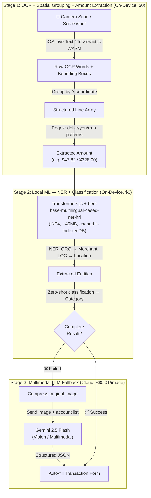

# Architecture Migration Plan: FinProject to Local-First Multi-Browser Extension & PWA

## 1. Executive Summary & Goal
The goal of this migration is to transition **FinProject** from a traditional Web SaaS (Next.js SSR + Remote Supabase PostgreSQL + VPS Docker) into a **Local-First Cross-Browser Extension and Standalone PWA**.

**Current Target Scope (Narrowed for Execution):**
1. **Firefox Desktop (Primary Dev/Test Target)**: For rapid iteration and functional testing as a Sidebar WebExtension.
2. **Safari iOS (Mobile Portrait)**: For the final mobile end-user experience via standalone PWA ("Add to Home Screen").

### Core Targets:
- **Zero Server Maintenance ($0/month)**: Eliminate VPS, Docker, and always-on database instances. Cloud infrastructure cost drops to $0/month using Cloudflare Pages/Vercel + Supabase Auth + Cloudflare R2/Supabase Storage.
- **Ultra-Fast Local Performance**: All financial queries (CRUD) run locally in the browser/app with zero network latency via `@electric-sql/pglite` (WASM PostgreSQL).
- **Zero-Fee Mobile Deployment (PWA Focus)**: Avoid Apple's $99/year developer fee by supporting iOS PWA, delivering a native-feel app experience on iPhone with offline support.
- **Top-Tier Mobile Portrait Experience**: Seamless one-handed logging, iOS Safe Area adaptation (`env(safe-area-inset-bottom)`), dynamic viewport height (`100dvh`), and gesture-driven bottom sheets.
- **Cross-Device Cloud Sync**: Multi-provider login via Supabase Auth with encrypted database snapshot synchronization.

---

## 2. Platform Feasibility & Target Environments

| Platform | Target Form Factor | Persistence Driver | Packaging / Distribution | Priority |
| :--- | :--- | :--- | :--- | :--- |
| **Firefox Desktop** | Sidebar / Toolbar Popup | IndexedDB / OPFS | `.xpi` WebExtension via WXT | **P0 (Dev Target)** |
| **iPhone (iOS Safari)** | Standalone PWA ("Add to Home Screen") | IndexedDB (`idb://finproject`) | PWA Manifest | **P1 (Mobile Target)** |
| **Marketing / Sync** | Landing Site & Cloud Storage | N/A | Cloudflare Pages + R2 Storage | **P2** |

*(Note: Chrome/Edge and Android Firefox support is deferred to later phases to focus on core functional delivery).*

---

## 3. Dedicated Adaptation Specs: Safari iOS & Firefox Desktop

### 3.1. Firefox Desktop Adaptation (Primary Testing Environment)
1. **Unified API**: Use WXT's built-in `browser` namespace (Promise-based `browser.*` APIs) for WebExtension development.
2. **Firefox Sidebar Action**: Declare `sidebar_action` in the extension manifest. This provides a persistent desktop side-panel experience, perfect for interacting with the extension while browsing other sites.
3. **Rapid Iteration**: Use Firefox as the primary sandbox for testing PGLite, React components, and local state management before deploying to mobile.

### 3.2. Safari iOS Mobile Portrait Adaptation
1. **Viewport & Safe Area Boundaries**:
   - Set viewport to `width=device-width, initial-scale=1.0, maximum-scale=1.0, user-scalable=no, viewport-fit=cover`.
   - Apply CSS environment variables:
     ```css
     padding-top: env(safe-area-inset-top);
     padding-bottom: env(safe-area-inset-bottom);
     ```
   - Use `100dvh` (Dynamic Viewport Height) to prevent layout jumping when the Safari URL bar collapses.
2. **Thumb-Zone Navigation & Mobile Layout**:
   - **Bottom Navigation Bar**: Sticky bottom tab bar (`Dashboard`, `Accounts`, `Transactions`, `Rewards`).
   - **Bottom Sheet Modal (Drawer)**: All transaction inputs open as slide-up bottom sheets with swipe-down dismissal.
   - **Input Optimization**: Font size >= 16px to prevent iOS auto-zoom on input focus. Native numeric keypad triggers (`inputMode="decimal"`).

---

## 4. System Architecture

```mermaid
graph TD
    subgraph "Local Client Engine (Firefox Sidebar / Safari PWA)"
        UI[React 19 + shadcn/ui<br/>(Mobile BottomSheet & Desktop Sidebar)]
        Engine[WASM PostgreSQL<br/>(@electric-sql/pglite)]
        LocalDB[(IndexedDB / OPFS<br/>idb://finproject)]
        LiveTextOCR[iOS Live Text / Local OCR Module]
        SyncWorker[Background Service Worker / Client SyncEngine]

        UI <-->|0ms Local Query| Engine
        Engine <--> LocalDB
        LiveTextOCR -->|Extracted Text| UI
        SyncWorker -->|Lazy Snapshot Catch-up & API Sync| Engine
    end

    subgraph "Serverless Cloud ($0 Zero Maintenance)"
        AuthService[Supabase Auth<br/>(Google, GitHub, Microsoft OAuth)]
        Storage[(Cloudflare R2 / Supabase Storage<br/>Encrypted Snapshot Sync)]
        GeminiAPI[Gemini 2.5 Flash Text API]
        LandingSite[Static Landing Website<br/>(Cloudflare Pages / Vercel)]
    end

    UI -->|Text-only Prompt| GeminiAPI
    SyncWorker <-->|Auth Token| AuthService
    SyncWorker <-->|Upload / Download encrypted .sql| Storage
```

---

## 5. Migration Roadmap (Step-by-Step)

### Phase 1: Build Tooling & WXT Setup (Highest Priority)
- [ ] Initialize extension architecture using **WXT** with React 19 + TypeScript + Tailwind CSS.
- [ ] Set up the development environment specifically for **Firefox Desktop Sidebar**.
- [ ] Configure PWA manifest (`public/manifest.webmanifest`) and iOS mobile metadata for standalone home-screen installation.
- [ ] Configure target build scripts:
  - `npm run dev:firefox` (Primary dev workflow)
  - `npm run build:firefox`
  - `npm run build:pwa` (Static web output for iOS Safari testing)

### Phase 2: Local Database Layer (@electric-sql/pglite)
- [ ] Integrate `@electric-sql/pglite` with IndexedDB persistence (`idb://finproject`).
- [ ] Test local database queries and schema migrations thoroughly in the **Firefox Desktop environment**.
- [ ] Refactor `lib/actions/*.ts` into client-side direct database queries.

### Phase 3: UI Redesign & Component Migration
- [ ] Migrate `components/` and `app/(dashboard)` UI into responsive views.
- [ ] **Desktop**: Adapt layout for the Firefox Sidebar constraint.
- [ ] **Mobile**: Implement Mobile Portrait layout with iOS Safe Area support and Bottom Sheet Drawers.
- [ ] Optimize Recharts components for narrow viewports.

### Phase 4: Multi-Provider Auth & Encrypted Snapshot Cloud Sync
- [ ] Implement OAuth flows (Google, GitHub, Microsoft) using Supabase Auth.
- [ ] Develop `SyncEngine`:
  - Debounced auto-backup of `.sql` dump to Cloudflare R2 / Supabase Storage.
  - Snapshot download and restore flow.

### Phase 5: Three-Stage AI Receipt Pipeline (Deferred)
- [ ] **Stage 1 — OCR + Spatial Grouping**:
  - [ ] Integrate iOS Live Text camera trigger via `<input type="file" capture="environment">`.
  - [ ] Add Tesseract.js (WASM) as fallback OCR engine.
  - [ ] Implement Y-coordinate line grouping and regex amount extractor.
- [ ] **Stage 2 — Local ML Classifier**:
  - [ ] Integrate Transformers.js with `Xenova/bert-base-multilingual-cased-ner-hrl` (~45MB INT4).
  - [ ] Build zero-shot classification wrapper.
- [ ] **Stage 3 — Multimodal LLM Fallback**:
  - [ ] Implement image compression.
  - [ ] Send compressed image to Gemini 2.5 Flash Vision API.

### Phase 6: Static Deployment & Decommission
- [ ] Deploy static PWA to Cloudflare Pages / Vercel.
- [ ] Verify standalone iOS Safari behavior and Firefox extension build.
- [ ] Decommission Docker / VPS server infrastructure.

---

## 6. Detailed Spec: Three-Stage AI Receipt Pipeline (Progressive Degradation)

Instead of always calling a cloud LLM, FinProject adopts a **progressive degradation** strategy.



### Stage Details:
#### Stage 1 — OCR + Spatial Line Grouping + Amount Extraction (On-Device)
- **iOS Safari PWA**: Leverage iOS Live Text via camera `<input>`.
- **Other browsers**: Tesseract.js (WASM, ~15MB).
- Cost: **$0**, Latency: **<500ms**

#### Stage 2 — Local ML: NER + Classification (On-Device)
- **Model**: `Xenova/bert-base-multilingual-cased-ner-hrl` (INT4 quantized, **~45MB**).
- Caching: Downloaded once and cached in browser Cache API / IndexedDB.
- Cost: **$0** (after initial ~45MB download), Latency: **<1s**

#### Stage 3 — Multimodal LLM Fallback (Cloud, Last Resort)
- Triggered only when local ML fails.
- Compress original image and send to Gemini 2.5 Flash Vision.
- Cost: **~$0.01/image**, Latency: **~1-2s**
