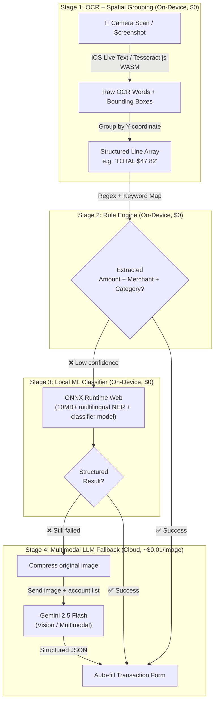

# Architecture Migration Plan: FinProject to Local-First Multi-Browser Extension & PWA

## 1. Executive Summary & Goal
The goal of this migration is to transition **FinProject** from a traditional Web SaaS (Next.js SSR + Remote Supabase PostgreSQL + VPS Docker) into a **Local-First Cross-Browser Extension and Standalone PWA**, with first-class focus on **Firefox** and **Safari iOS (Mobile Portrait)** alongside Chrome.

### Core Targets:
- **Zero Server Maintenance ($0/month)**: Eliminate VPS, Docker, and always-on database instances. Cloud infrastructure cost drops to $0/month using Cloudflare Pages/Vercel + Supabase Auth + Cloudflare R2/Supabase Storage.
- **Ultra-Fast Local Performance**: All financial queries (CRUD) run locally in the browser/app with zero network latency via `@electric-sql/pglite` (WASM PostgreSQL).
- **Zero-Fee Mobile Deployment (PWA Focus)**: Avoid Apple's $99/year developer fee by supporting iOS PWA ("Add to Home Screen"), delivering an identical standalone native-feel app experience on iPhone with offline support.
- **Top-Tier Mobile Portrait Experience**: Seamless one-handed logging, iOS Safe Area adaptation (`env(safe-area-inset-bottom)`), dynamic viewport height (`100dvh`), and gesture-driven bottom sheets.
- **Two-Stage AI Receipt Extraction**: On-device OCR (iOS Live Text / local WASM OCR) ➔ Text-only Gemini 2.5 Flash API (100ms ultra-fast, minimal tokens, 100% data privacy).
- **Cross-Device Cloud Sync**: Multi-provider login (Google, GitHub, Microsoft) via Supabase Auth with encrypted database snapshot synchronization.

---

## 2. Platform Feasibility & Target Environments

| Platform | Target Form Factor | Persistence Driver | Packaging / Distribution | Cost |
| :--- | :--- | :--- | :--- | :--- |
| **iPhone (iOS Safari)** | Standalone PWA ("Add to Home Screen") / Safari Ext | IndexedDB (`idb://finproject`) | PWA Manifest / Xcode Container App | **$0** (PWA mode) |
| **Firefox (Desktop/Android)** | Sidebar / Toolbar Popup | IndexedDB / OPFS | `.xpi` WebExtension via WXT | **$0** (Free Store) |
| **Chrome / Edge** | Side Panel / Toolbar Popup / Full Tab | OPFS / IndexedDB | `.zip` / CRX Manifest V3 | **$0** (Local/Unpacked) |
| **Marketing & Cloud Sync** | Landing Site & Encrypted Snapshot Storage | N/A | Cloudflare Pages + R2 Storage | **$0** (Free Tier) |

---

## 3. Dedicated Adaptation Specs: Safari iOS (Mobile Portrait) & Firefox

### 3.1. Safari iOS Mobile Portrait Adaptation
1. **Viewport & Safe Area Boundaries**:
   - Set viewport to `width=device-width, initial-scale=1.0, maximum-scale=1.0, user-scalable=no, viewport-fit=cover`.
   - Apply CSS environment variables:
     ```css
     padding-top: env(safe-area-inset-top);
     padding-bottom: env(safe-area-inset-bottom);
     ```
   - Use `100dvh` (Dynamic Viewport Height) to prevent layout jumping when the Safari URL bar collapses or the keyboard pops up.
2. **Thumb-Zone Navigation & Mobile Layout**:
   - **Bottom Navigation Bar**: Replace desktop top/side navigation with a sticky bottom tab bar (`Dashboard`, `Accounts`, `Transactions`, `Rewards`).
   - **Bottom Sheet Modal (Drawer)**: All transaction inputs, category selections, and account pickers open as slide-up bottom sheets with swipe-down dismissal.
   - **Input Optimization**: Font size >= 16px to prevent iOS Safari auto-zoom on input focus. Native numeric keypad triggers (`inputMode="decimal"`).
3. **Mobile-Responsive Chart Adaptation (Recharts)**:
   - Make Net Worth and Expense charts horizontally swipeable or vertically stacked in portrait mode.
   - Simplify tooltips for touch interactions (press-and-drag instead of hover).

### 3.2. Firefox Adaptation
1. **Unified API**: Use WXT's built-in `browser` namespace (Promise-based `browser.*` APIs) for clean execution across Firefox and Chromium.
2. **Firefox Sidebar Action**: Declare `sidebar_action` in Firefox manifest for a native desktop sidebar experience matching Chrome's `side_panel`.
3. **Android Firefox Support**: Responsive touch UI fits seamlessly into Firefox for Android.

---

## 4. Four-Stage AI Receipt Pipeline (Progressive Degradation)

Instead of always calling a cloud LLM, FinProject adopts a **progressive degradation** strategy — each stage runs only if the previous one fails, minimizing cost and latency while maximizing accuracy.



### Stage Details:

#### Stage 1 — OCR + Spatial Line Grouping (On-Device)
- **iOS Safari PWA**: Leverage iOS Live Text via camera `<input>` for high-quality Neural Engine OCR.
- **Other browsers**: Tesseract.js (WASM, ~15MB) with bounding-box output.
- **Key step**: Group OCR words into logical lines by Y-coordinate proximity, so `"TOTAL"` and `"$47.82"` on the same row are linked together.
- Cost: **$0**, Latency: **<500ms**

#### Stage 2 — Rule Engine (On-Device)
- Regex patterns extract `Total/合计/AMOUNT DUE` lines → parse dollar amount.
- First non-empty line or known header patterns → extract merchant name.
- Keyword-to-category mapping table (e.g. `"costco" → Grocery`, `"uber" → Transport`).
- If amount + merchant + category all extracted with high confidence → **done, skip remaining stages**.
- Cost: **$0**, Latency: **<10ms**

#### Stage 3 — Local ML Classifier (On-Device)
- **ONNX Runtime Web** running a **10MB+ multilingual model** for:
  - **Named Entity Recognition (NER)**: Extract amounts, dates, merchant names from messy OCR text.
  - **Text Classification**: Classify merchant/description into spending categories.
- Model is cached in IndexedDB after first download; runs entirely offline afterwards.
- If structured result is complete → **done, skip Stage 4**.
- Cost: **$0** (after initial model download), Latency: **<1s**

#### Stage 4 — Multimodal LLM Fallback (Cloud, Last Resort)
- Triggered only when all local stages fail (estimated <20% of receipts).
- Compress the **original image** (not OCR text) and send directly to Gemini 2.5 Flash Vision.
- The LLM "sees" the receipt image and returns structured JSON with amount, merchant, category, date.
- Cost: **~$0.01/image**, Latency: **~1-2s**

### Key Advantages:
- **80%+ receipts processed fully offline** with zero API cost and <500ms latency.
- **Maximum privacy**: Original images only leave the device in the rare Stage 4 fallback.
- **Graceful degradation**: Even the most illegible receipt gets handled — the pipeline never returns "failed".
- **Minimal cloud spend**: Only ~20% of receipts hit the paid API at ~$0.01 each.

---

## 5. System Architecture

```mermaid
graph TD
    subgraph "Local Client Engine (Cross-Browser via WXT / PWA)"
        UI[React 19 + shadcn/ui<br/>(Mobile BottomSheet & Desktop SidePanel)]
        Engine[WASM PostgreSQL<br/>(@electric-sql/pglite)]
        LocalDB[(IndexedDB / OPFS<br/>idb://finproject)]
        LiveTextOCR[iOS Live Text / Local OCR Module]
        SyncWorker[Background Service Worker / Client SyncEngine]

        UI <-->|0ms Local Query| Engine
        Engine <--> LocalDB
        LiveTextOCR -->|Extracted Text| UI
        SyncWorker -->|Lazy Snapshot Catch-up & API Sync| Engine
    end

    subgraph "Serverless Cloud ($0 Zero Maintenance)"
        AuthService[Supabase Auth<br/>(Google, GitHub, Microsoft OAuth)]
        Storage[(Cloudflare R2 / Supabase Storage<br/>Encrypted Snapshot Sync)]
        GeminiAPI[Gemini 2.5 Flash Text API]
        LandingSite[Static Landing Website<br/>(Cloudflare Pages / Vercel)]
    end

    UI -->|Text-only Prompt| GeminiAPI
    SyncWorker <-->|Auth Token| AuthService
    SyncWorker <-->|Upload / Download encrypted .sql| Storage
```

---

## 6. Migration Roadmap (Step-by-Step)

### Phase 1: Build Tooling & WXT Multi-Browser Setup
- [ ] Initialize extension architecture using **WXT (Next-Gen Web Extension Framework)** with React 19 + TypeScript + Tailwind CSS.
- [ ] Configure PWA manifest (`public/manifest.webmanifest`) and iOS mobile metadata for standalone home-screen installation.
- [ ] Configure multi-target build scripts:
  - `npm run build:chrome`
  - `npm run build:firefox`
  - `npm run build:safari`
  - `npm run build:pwa` (Static web output for Cloudflare Pages/Vercel)

### Phase 2: Mobile Portrait UI Redesign & Component Migration
- [ ] Implement Mobile Portrait layout with iOS Safe Area support (`env(safe-area-inset-bottom)` and `100dvh`).
- [ ] Build **Bottom Sheet Drawer** (using Vaul / Radix Sheet) for transaction and transfer creation.
- [ ] Migrate `components/` and `app/(dashboard)` UI into responsive views (Bottom Tabs on mobile portrait, Sidebar on desktop).
- [ ] Optimize Recharts components for touch gestures and narrow portrait viewports (375px - 430px).

### Phase 3: Local Database Layer (@electric-sql/pglite)
- [ ] Integrate `@electric-sql/pglite` with IndexedDB persistence (`idb://finproject`) for full Safari & Firefox compatibility.
- [ ] Refactor `lib/actions/*.ts` into client-side direct database queries (0ms latency, offline capable).
- [ ] Implement database schema migration runner to apply SQL schemas on initial client boot.

### Phase 4: Four-Stage AI Receipt Pipeline
- [ ] **Stage 1 — OCR + Spatial Grouping**:
  - [ ] Integrate iOS Live Text camera trigger via `<input type="file" capture="environment">`.
  - [ ] Add Tesseract.js (WASM) as cross-browser fallback OCR engine.
  - [ ] Implement Y-coordinate line grouping to produce structured `LineArray` from raw OCR bounding boxes.
- [ ] **Stage 2 — Rule Engine**:
  - [ ] Build regex-based amount extractor (supports `Total`, `合计`, `AMOUNT DUE`, multi-currency).
  - [ ] Build merchant name extractor (first-line heuristics + known header patterns).
  - [ ] Create keyword-to-category mapping table (`lib/data/receipt-categories.ts`).
- [ ] **Stage 3 — Local ML Classifier**:
  - [ ] Integrate ONNX Runtime Web with a 10MB+ multilingual NER + text classification model.
  - [ ] Cache model in IndexedDB for offline use after first download.
  - [ ] Build confidence scoring to decide whether to accept result or fall through to Stage 4.
- [ ] **Stage 4 — Multimodal LLM Fallback**:
  - [ ] Implement image compression (quality reduction + resize) before upload.
  - [ ] Send compressed image + user's account list to Gemini 2.5 Flash Vision API.
  - [ ] Parse structured JSON response and auto-populate transaction form.

### Phase 5: Multi-Provider Auth & Encrypted Snapshot Cloud Sync
- [ ] Implement OAuth flows (Google, GitHub, Microsoft) using Supabase Auth with `browser.identity.launchWebAuthFlow` / popup.
- [ ] Develop `SyncEngine`:
  - Debounced auto-backup of `.sql` dump to Cloudflare R2 / Supabase Storage on local changes.
  - Snapshot download and restore flow when logging in on a new device.
  - Implement lazy net-worth snapshot catch-up on app launch.

### Phase 6: Static Deployment & Decommission
- [ ] Deploy static PWA and marketing site to Cloudflare Pages / Vercel.
- [ ] Verify standalone iOS Safari "Add to Home Screen" behavior and Firefox extension build.
- [ ] Decommission Docker / VPS server infrastructure.
